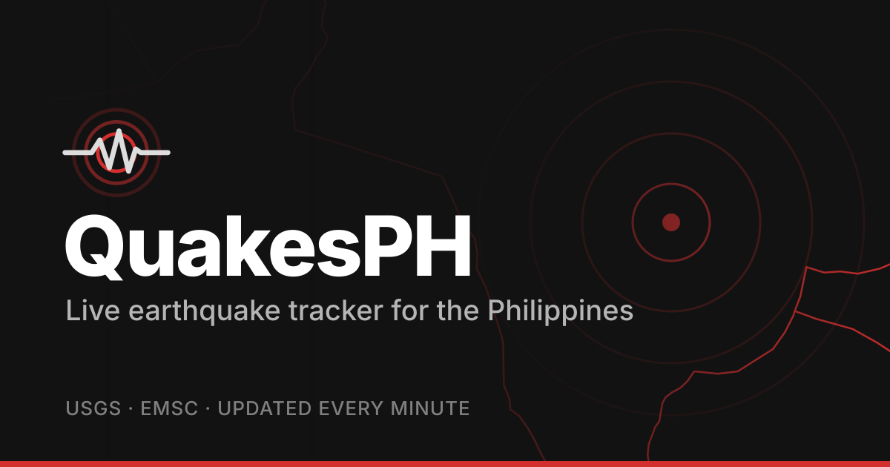

# 🌋 QuakesPH

**Live earthquake tracker for the Philippines.** See the latest quakes on an interactive map, filter by time and magnitude, and check how far the latest one was from you.

👉 **Live site:** https://juliusalfeche.github.io/quakesph/



## Features

- **Two data sources, one clean list.** USGS is the main source; EMSC fills in the smaller quakes (below M4). The same quake reported by both is shown once.
- **Interactive map** with circles sized and colored by magnitude, and a pulsing ring on the latest quake. If your device is set to *reduce motion*, the ring fades gently instead of pulsing.
- **Filters:** last hour / day / week / month, and All / M4+ / M5+ / M6+ / M7+. Your choices are remembered on your device.
- **Three map styles, no API key needed:** Dark (Esri Dark Gray), Satellite (Esri imagery) and Streets (OpenStreetMap).
- **Plate boundaries** layer (on or off), to show where the Philippines sits on the Pacific Ring of Fire.
- **Distance to the latest quake.** Tap *Show my distance*. Your location is used only in your browser. It is never saved or sent anywhere.
- **Updates every minute** (pauses while the tab is hidden).
- **Installable and works offline** as an app (PWA), on Android, iOS and desktop.
- **Accessible:** keyboard friendly, screen reader labels, visible focus, respects "reduce motion".

## Magnitude colors

| Class | Magnitude | Color |
|---|---|---|
| Minor | below 4 | blue |
| Light | 4 – 4.9 | yellow |
| Moderate | 5 – 5.9 | orange |
| Strong | 6 – 6.9 | red |
| Major | 7 and above | purple |

## Project structure

```
quakesph/
├── index.html
├── sw.js                 offline support
├── manifest.json         app install info
├── assets/
│   ├── css/style.css     all styling and the color palette
│   ├── js/
│   │   ├── config.js     settings: refresh time, colors, map limits
│   │   ├── utils.js      distance, dates, safe links
│   │   ├── quakes.js     cleans and merges the data
│   │   ├── api.js        talks to USGS and EMSC
│   │   ├── map.js        everything Leaflet (map, markers, layers)
│   │   ├── ui.js         draws the list, tiles and popups
│   │   └── main.js       connects everything
│   ├── data/plates-ph.json
│   ├── icons/            logo and app icons
│   └── images/cover.png  social preview image
├── tests/                automatic tests for the data logic
└── README.md, CHANGELOG.md, LICENSE
```

## Security and privacy

- No cookies, no analytics, no accounts, no API keys.
- A strict **Content Security Policy** limits what the page can load and connect to.
- The only outside code is **Leaflet 1.9.4**, pinned to an exact version and verified with an integrity hash.
- Text from outside servers is always inserted as plain text, and links are only allowed to USGS over https.
- Map tiles come from Esri and OpenStreetMap, so those services see your IP address when tiles load (the same as any website with a map).

## Data and credits

- Earthquakes: [USGS](https://earthquake.usgs.gov/) and [EMSC-CSEM](https://www.seismicportal.eu/)
- Plate boundaries: Peter Bird (2003), *An updated digital model of plate boundaries*
- Maps: [Esri](https://www.esri.com/) and [OpenStreetMap](https://www.openstreetmap.org/copyright) contributors
- Map library: [Leaflet](https://leafletjs.com/)

## Disclaimer

QuakesPH is for information only and is **not an official warning system**. Data can be late, incomplete or revised. For official bulletins, see [PHIVOLCS](https://earthquake.phivolcs.dost.gov.ph/).

## License

MIT. See [LICENSE](LICENSE).
